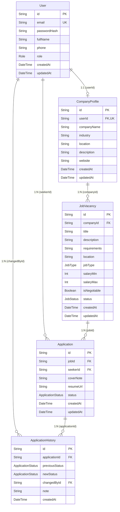

# IndoKerja.id - Database Architecture & Schema Documentation

Comprehensive documentation for the PostgreSQL database architecture, Prisma schema modeling, relationships, constraints, and audit history workflows.

---

## 1. Database Overview & Technology

- **Database Engine**: PostgreSQL 18 (Local instance on `localhost:5432`)
- **ORM**: Prisma ORM v6.4.1
- **Driver**: `@prisma/client`
- **Schema Location**: [`backend/prisma/schema.prisma`](file:///d:/TES%20INDOKERJA/backend/prisma/schema.prisma)
- **Migrations Location**: [`backend/prisma/migrations/`](file:///d:/TES%20INDOKERJA/backend/prisma/migrations/)

---

## 2. Entity Relationship Diagram (ERD)



---

## 3. Core Models & Field Specifications

### 3.1 `User`
Central account record for both Job Seekers and Company recruiters.
- `id`: UUID (Primary Key).
- `email`: Unique string, indexed for rapid lookups during authentication.
- `passwordHash`: Bcrypt-hashed string (10 rounds). Never exposed in API responses.
- `fullName`: Display name of the user.
- `phone`: Optional contact number.
- `role`: Enum `Role` (`JOB_SEEKER` or `COMPANY`).
- Relations:
  - `companyProfile`: Optional 1:1 relation with `CompanyProfile`.
  - `applications`: 1:N relation with `Application` as job seeker.
  - `historyChanges`: 1:N relation with `ApplicationHistory` recording audit changes made by this user.

### 3.2 `CompanyProfile`
Encapsulates verified company identity for recruiter accounts (`role === 'COMPANY'`).
- `id`: UUID (Primary Key).
- `userId`: Foreign key referencing `User.id` (Unique, 1:1).
- `companyName`: Name of the registered enterprise.
- `industry`, `location`, `description`, `website`: Optional profile metadata.
- Relations:
  - `user`: 1:1 relation with `User` with `onDelete: Cascade`.
  - `jobs`: 1:N relation with `JobVacancy`.

### 3.3 `JobVacancy`
Job vacancies created and managed by registered companies.
- `id`: UUID (Primary Key).
- `companyId`: Foreign key referencing `CompanyProfile.id`.
- `title`, `description`, `requirements`, `location`: Core job specifications.
- `jobType`: Enum `JobType` (`FULL_TIME`, `PART_TIME`, `CONTRACT`, `REMOTE`).
- `salaryMin`, `salaryMax`: Optional integers in Indonesian Rupiah.
- `isNegotiable`: Boolean flag for negotiable salary terms.
- `status`: Enum `JobStatus` (`OPEN` or `CLOSED`). Indexed for fast public query filtering.
- Relations:
  - `company`: References parent `CompanyProfile` with `onDelete: Cascade`.
  - `applications`: 1:N relation with candidate submissions.

### 3.4 `Application`
Represents an individual seeker's submission to an open job vacancy.
- `id`: UUID (Primary Key).
- `jobId`: Foreign key referencing `JobVacancy.id`.
- `seekerId`: Foreign key referencing `User.id`.
- `coverNote`: Optional introduction/cover letter (up to 2000 chars).
- `resumeUrl`: Optional publicly accessible portfolio/CV link.
- `status`: Current application lifecycle state (default: `APPLIED`).
- Constraints:
  - **`@@unique([jobId, seekerId])`**: Enforced at PostgreSQL level to guarantee a seeker cannot apply to the same vacancy more than once.
- Relations:
  - `job`: References `JobVacancy` with `onDelete: Cascade`.
  - `seeker`: References `User` with `onDelete: Cascade`.
  - `history`: 1:N relation with `ApplicationHistory` timeline.

### 3.5 `ApplicationHistory`
Immutable audit log recording every transition in an application's lifecycle.
- `id`: UUID (Primary Key).
- `applicationId`: Foreign key referencing parent `Application.id`.
- `previousStatus`: Status prior to the change (`null` for initial submission).
- `newStatus`: New status after the change.
- `changedById`: Foreign key referencing `User.id` (who executed the transition).
- `note`: Optional review or audit comment from the recruiter.
- `createdAt`: Timestamp when the audit event occurred.

---

## 4. Enums & Status Lifecycle Machine

### Database Enums
```prisma
enum Role {
  JOB_SEEKER
  COMPANY
}

enum JobType {
  FULL_TIME
  PART_TIME
  CONTRACT
  REMOTE
}

enum JobStatus {
  OPEN
  CLOSED
}

enum ApplicationStatus {
  APPLIED
  REVIEWING
  SHORTLISTED
  REJECTED
  ACCEPTED
}
```

### Unidirectional Lifecycle State Machine
Status transitions are strictly unidirectional to prevent state regression:
- **`APPLIED`** ➔ `REVIEWING`
- **`REVIEWING`** ➔ `SHORTLISTED` or `REJECTED`
- **`SHORTLISTED`** ➔ `ACCEPTED` or `REJECTED`
- **`ACCEPTED`** ➔ *(Terminal status, decisions are final)*
- **`REJECTED`** ➔ *(Terminal status, decisions are final)*

---

## 5. Transactional Integrity (`prisma.$transaction`)

Every state mutation in the system is executed within an atomic database transaction:

1. **Company Registration**:
   `User` + `CompanyProfile` are created atomically. If profile creation fails, the user is rolled back.
2. **Application Submission**:
   Inserts `Application` with status `APPLIED` and immediately writes the initial `ApplicationHistory` entry (`previousStatus: null`, `newStatus: APPLIED`) within the same transaction.
3. **Candidate Status Transition**:
   Updates `Application.status` and writes a new `ApplicationHistory` row atomically. If either fails, no partial status change is persisted.

---

## 6. Migration & Seeding Workflows

### Running Migrations
To inspect or apply existing migrations to a local or production database:
```powershell
# Check current migration status
npx prisma migrate status

# Apply existing migrations (Production / CI)
npx prisma migrate deploy

# Create and apply new migrations (Development only)
npx prisma migrate dev
```

### Database Seeding
To populate reproducible demo users, companies, vacancies, applications, and multi-stage audit logs:
```powershell
npm run prisma:seed
```
Seed data populates:
- Demo Company 1: `company@indokerja.id` / `Password123!` (PT Teknologi Nusantara)
- Demo Company 2: `company2@indokerja.id` / `Password123!` (PT Maju Bersama)
- Demo Seeker 1: `seeker@indokerja.id` / `Password123!` (Budi Santoso)
- Demo Seeker 2: `seeker2@indokerja.id` / `Password123!` (Siti Rahma)
- 3 Vacancies across different job types.
- 3 Applications across different lifecycle stages (`APPLIED`, `REVIEWING`, `SHORTLISTED`) with valid chronological history audit logs.
